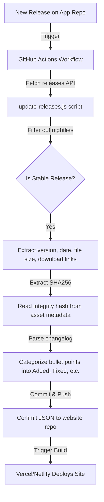

# Version Management System - Reference Guide

## System Overview

The Video Downloader App website uses a **fully automated version management system** powered by GitHub Actions. Whenever a new stable version is released on the main repository (`iam-sandipmaity/video-downloader`), the website automatically detects it, fetches the metadata, calculates integrity hashes, parses release notes, and deploys the updates.

### What Updates Automatically?
- ✅ Versions page (`/versions`)
- ✅ Changelog page (`/changelog`)
- ✅ Download section (home page - shows latest stable version)

---

## How the Automation Works



### 1. Automation script
The script located at [scripts/update-releases.js](file:///home/error/Prj/video-downloader-site/scripts/update-releases.js) is responsible for:
- Fetching releases via GitHub REST API.
- Skipping pre-releases and tags containing the word `nightly`.
- Downloading the APK to calculate the SHA256 checksum locally if not already provided in the asset metadata.
- Parsing release bullet points into `added`, `fixed`, `improved`, and `removed` sections.

### 2. GitHub Actions Workflow
The workflow located at [.github/workflows/update-versions.yml](file:///home/error/Prj/video-downloader-site/.github/workflows/update-versions.yml) handles:
- Running on a **cron schedule** (every 6 hours).
- Running on **repository dispatch** (for instant triggers on release).
- Committing the new JSON release data directly back to the `src/apk-data/` folder.

---

## Instant Trigger Setup (Optional)

To trigger the website to update **instantly** when you publish a release on the main `video-downloader` app repository:

1. Create a **Personal Access Token (PAT)** on GitHub with `repo` write permissions.
2. Save it as a secret named `WEBSITE_UPDATE_PAT` in your main `video-downloader` repository settings under **Settings > Secrets and variables > Actions**.
3. Add the following step to the end of your release workflow in the main app repository:

```yaml
- name: Trigger Website Update
  uses: peter-evans/repository-dispatch@v3
  with:
    token: ${{ secrets.WEBSITE_UPDATE_PAT }}
    repository: iam-sandipmaity/video-downloader-site
    event-type: on-new-release
```

---

## Manual Overrides & Custom Changelogs (Fallback)

If you ever want to write a custom descriptive changelog that is different or more detailed than the bullet points generated by GitHub:

1. Locate the generated JSON file in `src/apk-data/` (e.g., `v1.7.4.json`).
2. Manually edit the `changelog` object:
   ```json
   "changelog": {
     "added": ["Very detailed user-friendly feature explanation"],
     "fixed": ["Clear explanation of what crash was resolved"],
     "improved": [],
     "removed": [],
     "comingSoon": []
   }
   ```
3. Commit and push your edits to the website repository. Vercel will automatically redeploy the site with your custom notes.
